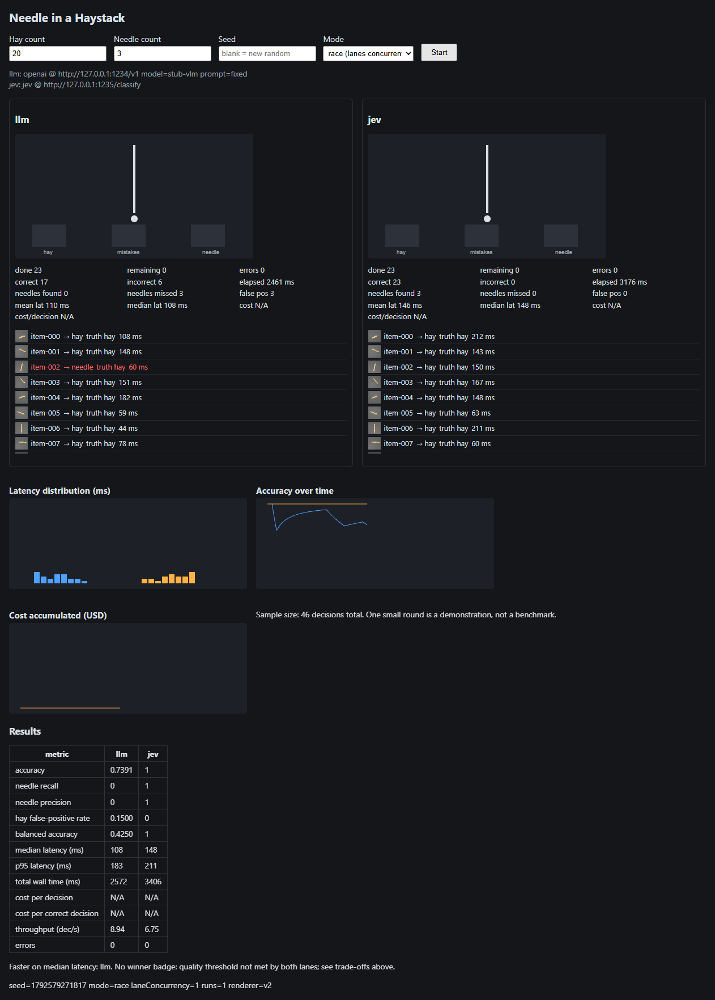

# 🧵 Needle in a Haystack

**A two-lane race between a big chat LLM and a small decision model — over real API calls, real images, and real numbers.**

Both lanes get the exact same pile of hay and needles, in the exact same shuffled order.
Each lane picks one item at a time, decides *hay* or *needle*, and drops it in a bin.
The needles might show up first, or on item 37. You watch both lanes crawl at their own honest pace.

Then the game shows you who was faster, who was cheaper, and who was right — measured, not narrated.



<sub>_A local run against stub endpoints — the lane answers come from a mock, the layout, the charts and the
end-of-round table are the real thing._</sub>

```
  ┌──────────────────────────────┐        ┌──────────────────────────────┐
  │  llm  (chat model)           │        │  jev  (decision model)       │
  │                              │        │                              │
  │        ┌────┐                │        │                ┌────┐        │
  │   ╱────┤    ├────╲           │        │           ╱────┤    ├────╲   │
  │  ╱     │    │     ╲          │        │          ╱     │    │     ╲  │
  │ ╱      └────┘      ╲         │        │         ╱      └────┘      ╲ │
  │ │   hay        needle │       │        │        │   hay        needle │
  └──────────────────────────────┘        └──────────────────────────────┘
     median 3.7s, acc 1.0                    median 9.0s, acc not measured
```

---

## Why this exists

Everyone *says* a narrow decision model beats a general chat LLM on a trivial repeated decision.
This repo lets you watch it happen — or not happen — with your own models, your own hardware,
and numbers nobody made up.

## Quickstart

```bash
npm install
npm start          # → http://localhost:8787
```

Open the page, pick how many hay and needles, hit **Start**, and watch.

No keys? It still runs — the lanes will simply report errors instead of answers, which is
also a valid demonstration of "a failed request is not a fast request".

## Lanes

A lane is one model that classifies each item. Three adapters ship in the box:

| adapter | what it speaks to | needs |
|---|---|---|
| `openai` | any OpenAI-compatible chat endpoint (Ollama, llama.cpp, LM Studio, vLLM, OpenAI itself) | `baseUrl`, `model`, optional `apiKeyEnv` |
| `jev` | your own tiny HTTP service: `POST` raw PNG bytes → `{"label":"hay"}` | `url` |
| `jevapi` | the hosted Jev decision API (`POST /api/v1/systemone/`) | `url`, `apiKeyEnv` |

Example `config/default.json`:

```json
{
  "lanes": [
    { "laneId": "llm", "adapter": "openai", "baseUrl": "http://localhost:11434/v1",
      "model": "minimax-m3.1-flash:cloud", "apiKeyEnv": "LLM_API_KEY",
      "prompt": "Classify this image as exactly one of: hay, needle. Answer with one word.",
      "timeoutMs": 30000, "pricePerMTokIn": null, "pricePerMTokOut": null },
    { "laneId": "jev", "adapter": "jevapi", "url": "https://jev-ai.org/api/v1/systemone/",
      "model": "jev-1.13", "apiKeyEnv": "JEV_API_KEY", "timeoutMs": 30000, "pricePerMTokIn": null }
  ],
  "imageSize": 256, "concurrency": 1, "retries": 0
}
```

Secrets come from the environment only (`apiKeyEnv`), never from the config file, never from
the browser, never from the export.

```bash
export LLM_API_KEY=...        # optional
export JEV_API_KEY=...        # optional
npm start
```

### The `jevapi` lane reads shapes, not pixels

The hosted Jev API takes **text** as its state — it has no image field. So that lane receives a
deterministic 48×48 mask of the sprite (no labels, no colour words — just the silhouette) and
lets the model decide. The mask is dumb; the decision is the model's. The UI and the export say
so out loud, because "both lanes saw the same image" would otherwise be a lie:

```
####################
####################
        ####
        ####
         ##
```

If you want a lane that truly sees pixels, point the `openai` adapter at a vision model
(`beam:cloud` and friends do **not** accept images — Ollama answers HTTP 400), or write a
`jev` service that forwards bytes to a local multimodal decision model.

## What the game refuses to do

- ❌ Simulate a decision. Every item is a real call.
- ❌ Call an unknown cost `$0`. Unknown cost is `null` and shows as **N/A**.
- ❌ Coerce a chatty answer. `"It is a needle."` is recorded as `invalid_output`, not `needle`.
- ❌ Drop failures from the maths. Errors stay in the denominators.
- ❌ Show `0` for "no needles were predicted" — that is `null` too.
- ❌ Hand out a winner badge unless both lanes clear a quality bar.
- ❌ Mix a re-run into the previous run's state.
- ❌ Leak a key into the browser or the export.

## Measured on this machine (10 items, race mode)

| lane | accuracy | balanced acc | median | p95 | errors | cost |
|---|---|---|---|---|---|---|
| `llm` — MiniMax M3.1 Flash (vision, cloud) | 1.00 / 0.90 | 1.00 / 0.93 | 3.1–3.7 s | 4.9–8.0 s | 0 | N/A |
| `jev` — hosted jev-1.13 (shape mask) | not measured¹ | — | ~9–13 s | — | 402 after 6 calls² | 1 credit/call |

¹ the account ran out of credits before we could re-measure it on the legible sprites.
² `402 Payment Required` — failed calls are never charged, and the game shows them as errors, not zeroes.

Two honest findings:

1. **Our first hay was too good.** A 1–2 px straw on a grey gradient disappears when a vision
   model downsamples it: both lanes scored ~0.3 and the game measured noise, not models. After
   making the sprites legible (thicker shapes, real contrast, flat background — and a test that
   downscales the sprite the way a model would), the chat lane jumped to **0.9–1.0**. If your
   model looks bad here, check the hay before you blame the model.
2. **The hosted decision API is slow from here.** Its own `latency_ms` says 0.44 s, but the
   round trip is ~9 s. That gap is their per-call overhead, not our network (a plain `GET`
   to the same host takes 0.9 s).

## The numbers it keeps

Accuracy, needle recall, needle precision, hay false-positive rate, balanced accuracy,
mean/median/p95 latency, throughput, cost per decision, cost per correct decision, and the
error count. Every run is written to `runs/<run-id>/` as JSONL plus a full
`export.json` with the manifest, the public config snapshot, the summary, and every record.

## Layout

```
src/generator/    seeded sprite rasterizer + manifest builder (no native deps)
src/adapters/     openai · jev · jevapi
src/orchestrator/ lanes, metrics, event bus
src/server.js     http + websocket + export
public/           the game (plain HTML/canvas, no framework)
config/           default.json
test/             node:test suites
```

Tests:

```bash
npm test
```

## Docs

- [`docs/superpowers/plans/2026-10-21-needle-in-haystack-game.md`](docs/superpowers/plans/2026-10-21-needle-in-haystack-game.md) — the build plan this repo was executed from
- [`docs/superpowers/specs/2026-10-21-needle-in-haystack-game-design-revised.md`](docs/superpowers/specs/2026-10-21-needle-in-haystack-game-design-revised.md) — the design
- [`docs/superpowers/handoff-2026-10-21.md`](docs/superpowers/handoff-2026-10-21.md) — state, gotchas, what is left

## License

MIT — see [LICENSE](LICENSE).
